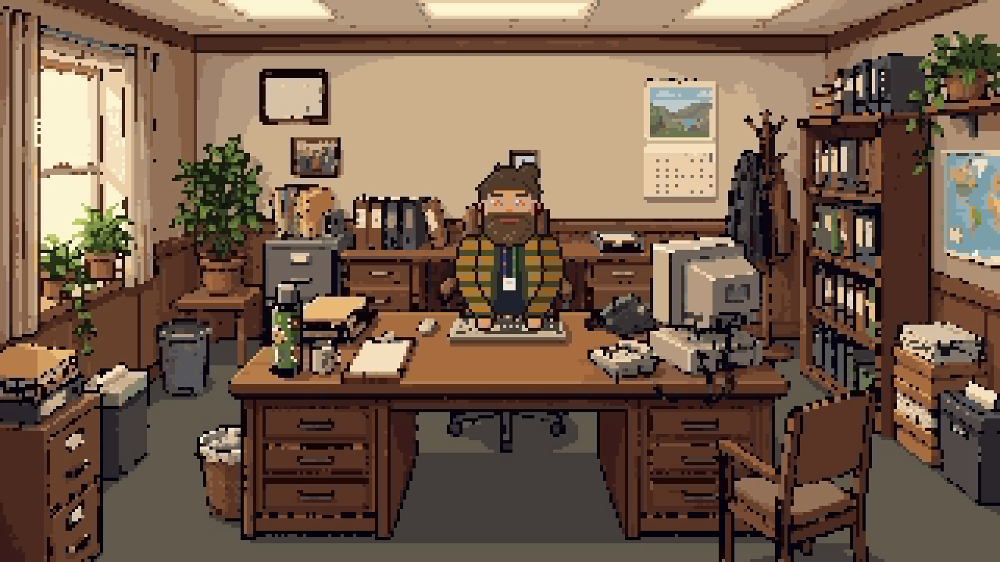

<p align="center">
  
</p>

<h1 align="center">Wolfgang</h1>

<p align="center">
  <b>Wolfgang wandelt um, damit du's nicht musst.</b><br>
  Bilder, Videos, Audio und Schriften – fürs Web oder fürs Archiv.<br>
  <sub>Für Macs mit Apple-Chip · macOS 13 oder neuer · Deutsch · ganz ohne Zusatzinstallationen</sub>
</p>

<p align="center">
  <a href="https://github.com/k1tesurfen/wolfgang/releases/latest/download/Wolfgang.dmg"></a><br>
  
</p>

---

> *„Moin! Leg mir einfach was auf den Tisch. Bilder, Videos, Musik, Schriften … ich guck's mir an.
> Kaffee ist da, Zeit hab ich auch.“*
> — Wolfgang

Wolfgang ist ein gemütlicher Typ mit Dutt, Vollbart, Brille und gestreifter Strickjacke. Er sitzt
in seinem kleinen Pixel-Büro, trinkt Kaffee und kümmert sich um all das, wofür man sonst fünf
verschiedene Programme und eine Suchmaschine bräuchte. Du ziehst ihm deine Dateien auf den
Schreibtisch, er stellt dir ein paar Fragen – und kurz darauf liegt alles fertig in einem Ordner
daneben. **Deine Originale fasst er dabei nie an.**

## Was Wolfgang kann

| | |
|---|---|
| **Bilder fürs Web** | WebP oder AVIF, auf die richtige Größe gebracht, ohne Metadaten (auch kein GPS), mit Dateinamen, die Google mag: `hotel-seeblick-terrasse-0001.webp` |
| **Bilder hochwertig behalten** | nur ein anderes Format (JPG, WebP, AVIF, PNG) – Originalgröße, Farbprofil bleibt erhalten |
| **Videos fürs Web** | MP4 (läuft überall) oder WebM (kleiner), in 720p, 1080p oder Originalgröße, auf Wunsch ohne Ton und mit Vorschaubild. iPhone-Videos in HDR sehen danach nicht flau aus. |
| **Audio** | MP3 oder AAC – passend eingestellt für Sprache (Podcast, Interview) oder Musik |
| **Schriften** | TTF, OTF und WOFF werden zu WOFF2 – eins zu eins, nichts wird weggelassen, und hinterher Glyphe für Glyphe nachgeprüft |

**Er liest fast alles:**
JPG, PNG, HEIC, AVIF, WebP, GIF, TIFF und Kamera-RAW (CR2, CR3, NEF, ARW, DNG) ·
MP4, MOV, M4V, MKV, WebM, AVI, MTS, MPG, WMV, 3GP ·
WAV, AIFF, FLAC, M4A, MP3, AAC, OGG, Opus, CAF, WMA ·
TTF, OTF, WOFF

Wolfgang gibt es als **App** – ein kleines Pixel-Büro, in dem du mit ihm redest – und als
**Kommandozeile** `wolfgang` für Skripte und Terminal-Fans. Beide führen dasselbe Gespräch und
teilen sich Einstellungen und Vorlagen.

---

## So kommst du zu Wolfgang

<p>
  <a href="https://github.com/k1tesurfen/wolfgang/releases/latest/download/Wolfgang.dmg"></a>
</p>

**Was dein Mac braucht:**

- einen **Apple-Chip** (M1, M2, M3, M4 …). Auf Macs mit Intel-Prozessor läuft Wolfgang nicht.
- **macOS 13 Ventura** oder neuer

Nachschauen kannst du das im Apple-Menü (oben links) → **Über diesen Mac**: Steht bei „Chip“ etwas mit
„Apple M…“ und bei „macOS“ eine 13 oder höher, passt alles.

1. Auf den Knopf oben klicken – das lädt `Wolfgang.dmg`, immer die neueste Version.
   (Ältere Versionen gibt's auf der [Releases-Seite](../../releases).)
2. Die Datei öffnen und **Wolfgang** in den Ordner **Programme** ziehen.
3. Wolfgang starten. Beim allerersten Mal braucht macOS einen kleinen Schubs (siehe unten).

Mehr musst du nicht installieren – kein Homebrew, kein ffmpeg, nichts. Wolfgang bringt alles mit.

### Der erste Start

Wolfgang ist (noch) nicht von Apple beglaubigt. macOS sagt deshalb beim ersten Start etwas wie
„Wolfgang kann nicht geöffnet werden, da Apple nicht überprüfen kann …“. Kein Grund zur Sorge:

1. Den Hinweis mit **Fertig** schließen.
2. **Systemeinstellungen → Datenschutz & Sicherheit** öffnen und ganz nach unten scrollen.
3. Bei „Wolfgang wurde blockiert …“ auf **Dennoch öffnen** klicken und bestätigen.

Das ist nur einmal nötig. Wer's lieber im Terminal mag:

```bash
xattr -dr com.apple.quarantine /Applications/Wolfgang.app
```

### Neue Versionen

Um Updates musst du dich nicht kümmern. Wolfgang schaut beim Start selbst nach, und wenn es
was Neues gibt, fragt er: *„Psst – es gibt 'nen neuen Wolfgang …“* Ein Klick, kurz warten,
fertig. Wer „Später“ sagt, findet das Angebot wieder, wenn man auf Wolfgang klickt.
(Das klappt ab Version 2.1. Von 2.0 aus einmal die neue `.dmg` von Hand installieren.)

---

## Ein Besuch bei Wolfgang

<p align="center">
  
</p>

Zieh Dateien oder ganze Ordner ins Fenster – direkt auf seinen Schreibtisch – oder aufs
Dock-Symbol. Wolfgang guckt sich den Stapel an und erzählt dir, was er sieht:

> *„Ich seh 42 Fotos, 3 Videos und eine Schrift. Mit einer Datei kann ich nix anfangen,
> die lass ich einfach liegen.“*

Dann fragt er nach, was er wissen muss – erst zu den Fotos, dann zu den Videos, dann zum Audio.
Nicht mehr als nötig: Schriften brauchen gar keine Fragen, und wenn keins der Videos Ton hat,
fragt er auch nicht danach. Kurz vor dem Loslegen fasst er alles zusammen:

> *„Also: 42 Fotos fürs Web als WebP, 1600 px, Qualität 80 – Dateinamen wie
> „hotel-seeblick-0001.webp“ und 3 Videos als MP4, 1080p, mit Ton und Vorschaubild,
> dazu eine Schrift als WOFF2. Landet alles in „Hotel-wolfgang“. Passt das so?“*

Während er arbeitet, tippt er, stempelt und nippt am Kaffee. Danach reicht er dir den Ordner
rüber – mit „📂 Im Finder zeigen“ bist du direkt da.

| Was | Wie |
|---|---|
| Antworten | anklicken, oder **↑ ↓** und **Enter**. **Esc** = zurück, **Leertaste** = Wolfgangs Text sofort ganz zeigen |
| Eigene Antwort | „✎ Selbst eintippen …“, z. B. eine eigene Größe |
| „So wie letztes Mal“ | Wolfgang merkt sich deine letzte Wahl – für Fotos, Videos und Audio jeweils einzeln |
| Vorlagen | nach getaner Arbeit „Als Vorlage merken“; ansehen und löschen über das **Klemmbrett** |
| Einstellungen | auf den **Computer** klicken: Lieblingsformate, Größe, Qualität, Schreibweise, Geräusche |
| Über Wolfgang | auf **Wolfgang selbst** klicken – dort gibt's auch die Kommandozeile |
| Kaffeepause | auf die **Tasse** klicken |
| Größer / kleiner | **⌘+** / **⌘−** (Wolfgang merkt sich die Größe), **⌘0** = Standard |

---

## Gut zu wissen

**Wohin kommt alles?** In einen Ordner `…-wolfgang` direkt neben dem, was du ihm gegeben hast.
Unterordner werden gespiegelt, Schriften landen unter `fonts/`.

**Dateinamen für Web-Bilder** setzen sich zusammen aus `[Vorsilbe]-[Stichworte]-[alter Name]-[Nummer]`.
Umlaute werden zu `ae`, `oe`, `ue`, `ss`, die Nummer zählt pro Ordner in Finder-Reihenfolge.

**Stichworte:** Liegt in einem Bilderordner eine `.txt`-Datei mit Stichworten (eins pro Zeile),
nimmt Wolfgang die. Sonst fragt er: *„Worum geht's auf den Bildern?“*

**Videos und Audio** behalten ihren Namen, nur websicher: „Drohne Strand FINAL.MOV“ wird
`drohne-strand-final.mp4`, das Vorschaubild liegt als `drohne-strand-final.webp` daneben. Bei
Videos fliegen alle Metadaten raus (auch der Aufnahmeort), bei Audio bleiben Titel und Interpret
drin. WebM braucht deutlich länger als MP4 – der Fortschrittsbalken läuft auch innerhalb eines
langen Videos weiter, und „Abbrechen“ hört sofort auf.

**Nochmal ablegen:** Gibst du Wolfgang denselben Ordner noch einmal, erkennt er, was schon fertig
ist – *„Moment, die kenn ich doch!“* – und macht auf Wunsch nur die neuen Dateien.

**Schriften** werden nach ihren eigenen Angaben benannt (`inter-700-italic.woff2`).

**Einstellungen und Vorlagen** liegen in `~/Library/Application Support/Wolfgang/settings.json`
und gelten für App und Kommandozeile gemeinsam.

---

## Wolfgang im Terminal

In der App auf **Wolfgang** klicken → **Installieren**. macOS fragt einmal nach deinem Passwort,
danach gibt es den Befehl `wolfgang` in jedem Terminal. Dort führt er dasselbe Gespräch wie in der
App, nur mit Pfeiltasten – und mit seinem Porträt in bunten Klötzchen:

```bash
wolfgang ~/Bilder/Urlaub          # Wolfgang fragt, was du willst
wolfgang                          # Ordner ins Fenster ziehen oder Enter für den aktuellen
```

Optionen beantworten seine Fragen vorab. Mit `--yes` (oder in Skripten) fragt er gar nicht:

```bash
wolfgang --web -f avif -d 1600 -n "Hotel Seeblick" ~/Bilder/Hotel
wolfgang --hq -f png ~/Scans
wolfgang --only fonts ~/Projekt
wolfgang --only videos --video-format webm --video-size 720 --no-sound ~/Filme/Loop
wolfgang --audio speech ~/Podcast
wolfgang -p "Blog-Bilder" --yes ~/Bilder/Neu
wolfgang --json --yes ~/Bilder | jq .        # eine JSON-Zeile pro Ereignis
```

<details>
<summary><b>Alle Optionen</b></summary>

| Option | Bedeutung |
|---|---|
| `--web` / `--hq` | Bilder fürs Web vorbereiten / hochwertig behalten |
| `-f, --format` | `webp`, `avif` (Web) oder `jpg`, `png`, `webp`, `avif` (hochwertig) |
| `-d, --size` | längste Seite in Pixeln (Web, Standard 1600) |
| `-q, --quality` | 1–100 (Web, Standard 80) |
| `-n, --name` | Vorsilbe für die Dateinamen |
| `-k, --keywords` | Stichworte für Ordner ohne Stichwortzettel |
| `-s, --separator` | `dash` (bild-name), `underscore` (bild_name), `caps` (BildName) |
| `-a, --append` | alten Dateinamen mit in den neuen Namen |
| `--video-format` | `mp4` (Standard) oder `webm` |
| `--video-size` | `720`, `1080` (Standard), `original` oder die kürzere Seite in Pixeln |
| `--video-quality` | `smaller`, `balanced` (Standard), `nicer` |
| `--no-sound` / `--no-poster` | Videos ohne Ton / ohne Vorschaubild |
| `--audio-format` | `mp3` (Standard) oder `aac` |
| `--audio` | was drauf ist: `speech`, `music` (Standard), `best` |
| `-p, --preset` | gespeicherte Vorlage benutzen |
| `--only images\|videos\|audio\|fonts` | nur einen Stapel bearbeiten |
| `--all` | auch schon Umgewandeltes nochmal machen |
| `-y, --yes` | nicht fragen |
| `--json` | maschinenlesbare Ausgabe |

Weitere Befehle: `wolfgang presets`, `wolfgang settings`, `wolfgang settings set web-format avif`,
`wolfgang legacy-reset ORDNER` (siehe unten). Exit-Codes: 0 ok, 1 einzelne Dateien fehlgeschlagen,
2 falsche Bedienung, 130 abgebrochen.

</details>

### Vom alten Wolfgang (1.x) umsteigen

Der alte Wolfgang hat deine **Originaldateien umbenannt** (`DSC_4711.jpg` → `DSC_4711-0001.jpg`).
Das macht der neue nie. Alte Umbenennungen machst du so rückgängig:

```bash
wolfgang legacy-reset ~/Bilder/Urlaub          # zeigt erst, was passieren würde
wolfgang legacy-reset ~/Bilder/Urlaub --yes    # benennt zurück
```

Es werden nur Dateien zurückbenannt, die im alten Logbuch stehen. Der alte Bash-Wolfgang liegt in
[`legacy/`](legacy/).

---

## Für Entwickler

<details>
<summary><b>Bauen, testen, veröffentlichen</b></summary>

```bash
brew install cmake nasm pkg-config autoconf automake libtool   # nur zum Bauen der Codecs
scripts/build-ffmpeg.sh                          # Wolfgangs eigenes ffmpeg (~10 Min., nur einmal)
cargo test --workspace                           # alle Tests
cargo run --release -p wolfgang-cli -- ~/Bilder  # Kommandozeile
cargo run --release -p wolfgang-app              # App
cargo install tauri-cli --version "^2" --locked  # einmalig, für das Paket:
scripts/build-app.sh                             # → target/release/bundle/dmg/*.dmg
./install.sh                                     # nur die Kommandozeile nach /usr/local/bin
```

| Ordner | Was |
|---|---|
| `crates/wolfgang-core` | die Umwandlung: Ordner einlesen, Namen, Bilder (Apple ImageIO + mozjpeg/libwebp/rav1e), Schriften (Google woff2), Videos/Audio (ffmpeg), Logbuch, Einstellungen |
| `crates/wolfgang-dialogue` | das Gespräch als Zustandsmaschine |
| `dialogue/de.yaml` | **alles, was Wolfgang sagt** – zum Ausprobieren ohne neu zu bauen: `WOLFGANG_DIALOGUE=dialogue/de.yaml wolfgang …` |
| `crates/wolfgang-cli` | der Befehl `wolfgang` |
| `crates/wolfgang-app` | die App (Tauri 2, Oberfläche in `ui/` als schlichtes HTML/CSS/JS) |
| `crates/wolfgang-art` | baut die Pixel-Art, siehe [`assets/pixel/README.md`](assets/pixel/README.md) |
| `assets/pixel/src` | Büro, Porträts und Sprites – von Hand gezeichnet, direkt bearbeiten |
| `scripts/build-ffmpeg.sh` | baut ffmpeg + ffprobe nach `target/ffmpeg/bin` (siehe unten) |
| `PLAN.md` | der Plan und alle Entscheidungen |

Die Oberfläche lässt sich auch im normalen Browser ansehen (mit Platzhalter-Daten):
`cd crates/wolfgang-app/ui && python3 -m http.server`, dann z. B. `http://localhost:8000/?demo=confirm`.

**ffmpeg:** Wolfgang nimmt nie das ffmpeg aus Homebrew, sondern sein eigenes, das in der App
neben der Kommandozeile liegt (`./install.sh` legt es nach `/usr/local/libexec/wolfgang`).
Gebaut wird es von `scripts/build-ffmpeg.sh` mit festen Versionen und Prüfsummen, nur aus
LGPL-Teilen: Apples VideoToolbox (H.264) und AudioToolbox (AAC), libvpx (VP9), Opus, LAME (MP3)
und zimg (HDR → SDR) – kein x264/x265. Neue Versionen: Nummern und Prüfsummen im Skript ändern,
CI baut dann neu. Zum Testen mit einem anderen ffmpeg: `WOLFGANG_FFMPEG_DIR=/pfad/zum/ordner`.
Ohne gebautes ffmpeg werden die Video-/Audio-Tests übersprungen.

**Eine neue Version veröffentlichen:** Version in `Cargo.toml` (workspace) und
`crates/wolfgang-app/tauri.conf.json` anheben, committen, Tag `vX.Y.Z` pushen. GitHub baut die
`.dmg` (zweimal: mit Versionsnummer und als `Wolfgang.dmg` für den Download-Knopf im README)
und die signierten Update-Dateien (`Wolfgang.app.tar.gz`, `latest.json`) und legt ein
Release als Entwurf an. Sobald es veröffentlicht ist, bieten alle installierten Wolfgangs das
Update an.

**Update-Schlüssel:** Updates werden mit einem eigenen Schlüssel signiert (nicht Apple). Er liegt
als Secret `TAURI_SIGNING_PRIVATE_KEY` (+ `_PASSWORD`) im GitHub-Repo und lokal in
`~/.tauri/wolfgang.key`. **Gut aufheben:** Geht er verloren, nehmen installierte Wolfgangs keine
Updates mehr an und müssen einmal von Hand neu installiert werden. Der öffentliche Teil steht in
`tauri.conf.json`.

</details>

---

## Lizenz & Dank

MIT © k1te – siehe [LICENSE](LICENSE).

- Schrift: [Pixelify Sans](https://github.com/eifetx/Pixelify-Sans), SIL Open Font License
- Videos und Audio: [FFmpeg](https://ffmpeg.org) unter der LGPL 2.1 (Lizenztext in der App unter
  `Contents/Resources/LICENSE-ffmpeg.txt`, Quellen und Bauweise: `scripts/build-ffmpeg.sh`), mit
  [libvpx](https://chromium.googlesource.com/webm/libvpx) (BSD), [Opus](https://opus-codec.org) (BSD),
  [LAME](https://lame.sourceforge.io) (LGPL) und [zimg](https://github.com/sekrit-twc/zimg) (WTFPL)

<p align="center"><sub>☕ Gebraut mit viel Kaffee. Wolfgang wünscht einen schönen Tag.</sub></p>
